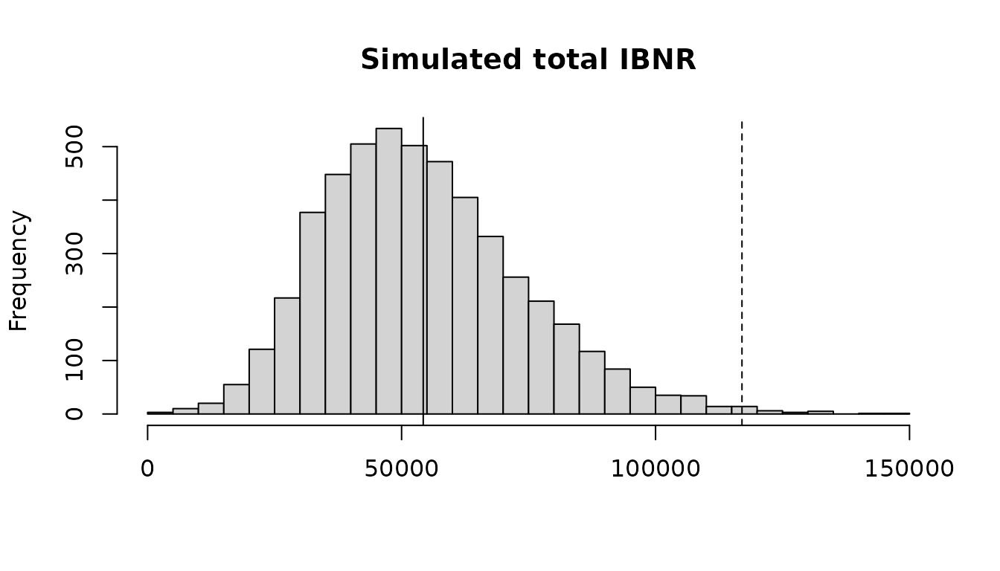

# Claims reserving with the chain ladder and its relatives

## 1. Introduction

This vignette estimates the reserves of a claims triangle: the claims of
each origin period (such as an accident year) that are still to be paid
or reported. It goes from the chain ladder to methods that use premiums,
measures how uncertain the reserves are, and projects paid and incurred
claims together.

Every method here also runs in the reserving tool,
[`run_shiny_reserving_tool()`](https://netsimanalytics.github.io/NetSimR/reference/run_shiny_reserving_tool.md),
where the link ratios can be left out with a click and the method of
each origin chosen from a list.

## 2. A triangle

A triangle is a matrix of cumulative claims, one row per origin and one
column per development period, with `NA` for the future. `raa_triangle`
holds the incurred claims of the Reinsurance Association of America (in
thousands), a triangle much used to compare methods:

``` r

library("NetSimR")
raa_triangle
```

    ##       development
    ## origin    1     2     3     4     5     6     7     8     9    10
    ##   1981 5012  8269 10907 11805 13539 16181 18009 18608 18662 18834
    ##   1982  106  4285  5396 10666 13782 15599 15496 16169 16704    NA
    ##   1983 3410  8992 13873 16141 18735 22214 22863 23466    NA    NA
    ##   1984 5655 11555 15766 21266 23425 26083 27067    NA    NA    NA
    ##   1985 1092  9565 15836 22169 25955 26180    NA    NA    NA    NA
    ##   1986 1513  6445 11702 12935 15852    NA    NA    NA    NA    NA
    ##   1987  557  4020 10946 12314    NA    NA    NA    NA    NA    NA
    ##   1988 1351  6947 13112    NA    NA    NA    NA    NA    NA    NA
    ##   1989 3133  5395    NA    NA    NA    NA    NA    NA    NA    NA
    ##   1990 2063    NA    NA    NA    NA    NA    NA    NA    NA    NA

Data usually comes as a table, one row per origin and development
period, or one row per payment.
[`as_triangle()`](https://netsimanalytics.github.io/NetSimR/reference/as_triangle.md)
builds the triangle from it. With incremental amounts, those of the same
cell are added up:

``` r

head(simulated_motor_claims)
```

    ##   accident_year development_year    paid incurred earned_premium
    ## 1          2014                1 1644095  3709012        8150000
    ## 2          2014                2 1502381  1044516        8150000
    ## 3          2014                3  714586   164925        8150000
    ## 4          2014                4  491949   222467        8150000
    ## 5          2014                5  362668    48340        8150000
    ## 6          2014                6  249976    64828        8150000

``` r

motor <- as_triangle(simulated_motor_claims, "accident_year", "development_year", "paid", cumulative = FALSE)
motor[1:4, 1:6]
```

    ##       development
    ## origin       1       2       3       4       5       6
    ##   2014 1644095 3146476 3861062 4353011 4715679 4965655
    ##   2015 1879754 3451386 4286565 4805419 5109496 5419496
    ##   2016 1948022 3576956 4752049 5456660 5792357 6080841
    ##   2017 2248011 3842756 5095157 5668707 6200949 6579528

## 3. The chain ladder and Mack’s standard errors

The chain ladder develops each origin’s latest claims to ultimate with
the average ratio of one development period’s claims to the previous
one’s.
[`chain_ladder()`](https://netsimanalytics.github.io/NetSimR/reference/chain_ladder.md)
also gives Mack’s standard error of each origin’s reserve and of the
total, split into the process error (the randomness of the claims to
come) and the parameter error (that of the estimated factors):

``` r

cl <- chain_ladder(raa_triangle)
cl
```

    ## Chain ladder 
    ## 
    ##  origin  latest developed ultimate   ibnr     se    cv process_se parameter_se
    ##    1981  18,834     1.000   18,834      0      0                0            0
    ##    1982  16,704     0.991   16,858    154    143 0.928        104           98
    ##    1983  23,466     0.974   24,083    617    592 0.959        451          383
    ##    1984  27,067     0.943   28,703  1,636    713 0.436        530          476
    ##    1985  26,180     0.905   28,927  2,747  1,452 0.529      1,219          790
    ##    1986  15,852     0.813   19,501  3,649  1,995 0.547      1,820          817
    ##    1987  12,314     0.694   17,749  5,435  2,204 0.405      2,039          837
    ##    1988  13,112     0.546   24,019 10,907  5,354 0.491      4,946        2,051
    ##    1989   5,395     0.336   16,045 10,650  6,332 0.595      6,034        1,918
    ##    1990   2,063     0.112   18,402 16,339 24,566 1.503     23,464        7,275
    ##   Total 160,987     0.755  213,122 52,135 26,881 0.516     24,917       10,085

``` r

round(cl$factors, 3)
```

    ##   1-2   2-3   3-4   4-5   5-6   6-7   7-8   8-9  9-10 
    ## 2.999 1.624 1.271 1.172 1.113 1.042 1.033 1.017 1.009

The IBNR is the ultimate less the latest claims: for an incurred
triangle the claims not yet reported, for a paid one the case reserves
as well. These results match those of the ChainLadder package’s
`MackChainLadder()`.

### Choosing the factors

The volume-weighted factors can be replaced by simple averages, limited
to the latest calendar periods, or computed without the link ratios that
look out of line. The first link ratio of 1982 is 40: its claims grew
from 106 to 4,285.

``` r

round(cl$link_ratios[1:3, 1:3], 2)
```

    ##       development
    ## origin   1-2  2-3  3-4
    ##   1981  1.65 1.32 1.08
    ##   1982 40.42 1.26 1.98
    ##   1983  2.64 1.54 1.16

``` r

exclude <- matrix(FALSE, 10, 9)
exclude[2, 1] <- TRUE
selected <- chain_ladder(raa_triangle, average = "simple", periods = 5, exclude = exclude)
round(selected$factors, 3)
```

    ##   1-2   2-3   3-4   4-5   5-6   6-7   7-8   8-9  9-10 
    ## 5.420 1.889 1.229 1.190 1.127 1.043 1.034 1.018 1.009

``` r

selected$total[c("ultimate", "ibnr", "se")]
```

    ##  ultimate      ibnr        se 
    ## 236873.41  75886.41  27435.99

### A tail

The triangle stops at ten years, but claims can develop after that. A
tail factor takes the last development period to ultimate. It can be
entered, or fitted as a curve to the factors and extrapolated:

``` r

tailed <- chain_ladder(raa_triangle, tail = "exponential")
tailed$tail
```

    ## [1] 1.009436

``` r

tailed$total[c("ultimate", "ibnr", "se")]
```

    ##  ultimate      ibnr        se 
    ## 215133.20  54146.20  27153.69

## 4. Methods with premiums

The chain ladder relies only on each origin’s own claims, which for the
latest origins are few. The Bornhuetter-Ferguson method adds an a priori
ultimate, premium times an expected loss ratio, and keeps the latest
claims plus the share of the a priori still to develop. Benktander
iterates the method once more, and the Cape Cod estimates the loss ratio
from the triangle itself. The simulated motor portfolio has premiums:

``` r

premium <- unique(simulated_motor_claims[c("accident_year", "earned_premium")])$earned_premium
cl_motor <- chain_ladder(motor)
bf <- bornhuetter_ferguson(cl_motor, premium, loss_ratio = 0.68)
bk <- bornhuetter_ferguson(cl_motor, premium, loss_ratio = 0.68, iterations = 2)
cc <- cape_cod(cl_motor, premium)
cc$total[["loss_ratio"]]
```

    ## [1] 0.6971151

``` r

ultimates <- data.frame(
  origin = cl_motor$by_origin$origin,
  developed = round(cl_motor$by_origin$developed, 3),
  chain_ladder = round(cl_motor$by_origin$ultimate),
  bornhuetter_ferguson = round(bf$by_origin$ultimate),
  benktander = round(bk$by_origin$ultimate),
  cape_cod = round(cc$by_origin$ultimate)
)
tail(ultimates, 4)
```

    ##    origin developed chain_ladder bornhuetter_ferguson benktander cape_cod
    ## 9    2022     0.826      6801772              6900577    6818999  6932912
    ## 10   2023     0.724      7311556              7476373    7357122  7531398
    ## 11   2024     0.565      9692085              8938032    9364312  9025090
    ## 12   2025     0.300      8078939              7985219    8013302  8125270

For the latest years the chain ladder multiplies few claims by large
factors: for 2024, 57% developed, its ultimate is 9.7 million, against
8.9 to 9.4 million from the methods that lean on the premium. For the
older years all the methods agree. Divided by the premiums, the
ultimates give each year’s loss ratio, a starting point for pricing:

``` r

round(tail(cc$by_origin$ultimate_loss_ratio, 4), 3)
```

    ## [1] 0.640 0.648 0.771 0.695

## 5. How uncertain the reserves are

### Until the claims are all paid

Mack’s standard error measures the uncertainty of the reserve until
every claim is paid. A bootstrap gives the whole distribution: England
and Verrall’s method resamples the residuals of an over-dispersed
Poisson chain ladder, refits it to each simulated triangle and simulates
the future payments:

``` r

boot <- bootstrap_chain_ladder(raa_triangle, n = 5000, seed = 1)
round(boot$total[c("ibnr", "se", "p75", "p99.5")])
```

    ##   ibnr     se    p75  p99.5 
    ##  54261  19720  66117 117015

``` r

hist(boot$total_reserves, breaks = 50, main = "Simulated total IBNR", xlab = NULL)
abline(v = boot$total[c("ibnr", "p99.5")], lty = c(1, 2))
```



### Over one year

Solvency II looks at one year: how much the ultimate can move as the
next year’s claims emerge and the factors are estimated again, the
claims development result. Merz and Wuthrich’s formulas give its
standard error, which is below Mack’s, as part of the uncertainty is
resolved only in later years:

``` r

merz_wuthrich(raa_triangle)
```

    ## Merz-Wuthrich one-year claims development result 
    ## 
    ##  origin  latest ultimate   ibnr one_year_se mack_se
    ##    1981  18,834   18,834      0           0       0
    ##    1982  16,704   16,858    154         143     143
    ##    1983  23,466   24,083    617         570     592
    ##    1984  27,067   28,703  1,636         378     713
    ##    1985  26,180   28,927  2,747       1,299   1,452
    ##    1986  15,852   19,501  3,649       1,668   1,995
    ##    1987  12,314   17,749  5,435       1,186   2,204
    ##    1988  13,112   24,019 10,907       4,691   5,354
    ##    1989   5,395   16,045 10,650       4,707   6,332
    ##    1990   2,063   18,402 16,339      23,610  24,566
    ##   Total 160,987  213,122 52,135      25,166  26,881

## 6. Paid and incurred claims together

The chain ladders of paid and of incurred claims often disagree. An
origin whose paid claims are low against its incurred claims is
projected low on paid and high on incurred. The Munich chain ladder of
Quarg and Mack corrects each factor by how far the origin’s paid to
incurred ratio is from its development period’s average, so that the two
projections meet:

``` r

mcl <- munich_chain_ladder(quarg_mack_paid, quarg_mack_incurred)
shown <- mcl$by_origin[, c("origin", "latest_ratio", "chain_ladder_paid", "chain_ladder_incurred",
                           "ultimate_paid", "ultimate_incurred")]
shown[-1] <- round(shown[-1], 2)
shown
```

    ##   origin latest_ratio chain_ladder_paid chain_ladder_incurred ultimate_paid
    ## 1      1         0.98           2131.00               2174.00       2131.00
    ## 2      2         0.96           2380.39               2445.00       2384.84
    ## 3      3         0.97           4652.18               4581.51       4553.62
    ## 4      4         0.95           6181.61               6126.36       6069.51
    ## 5      5         0.96           5055.60               4839.02       4878.95
    ## 6      6         0.91           4934.09               4476.12       4599.00
    ## 7      7         0.41           6128.34               8428.84       7504.58
    ##   ultimate_incurred
    ## 1           2174.00
    ## 2           2443.22
    ## 3           4634.36
    ## 4           6182.35
    ## 5           4957.81
    ## 6           4672.40
    ## 7           7655.38

## 7. References

Mack, T. (1993). Distribution-free calculation of the standard error of
chain ladder reserve estimates. ASTIN Bulletin 23(2), 213-225.

England, P. D. and Verrall, R. J. (2002). Stochastic claims reserving in
general insurance. British Actuarial Journal 8(3), 443-518.

Merz, M. and Wuthrich, M. V. (2008). Modelling the claims development
result for solvency purposes. CAS E-Forum, Fall 2008, 542-568.

Quarg, G. and Mack, T. (2004). Munich chain ladder. Blatter DGVFM 26(4),
597-630.
